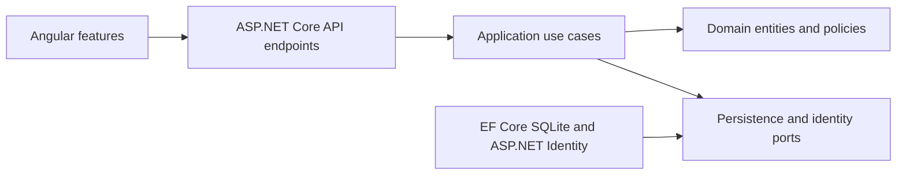
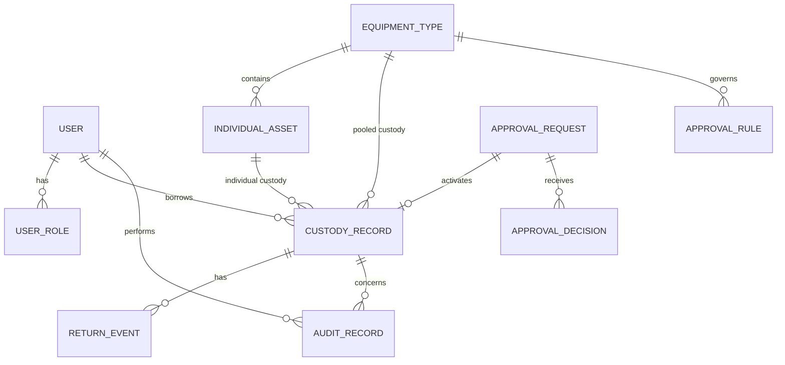
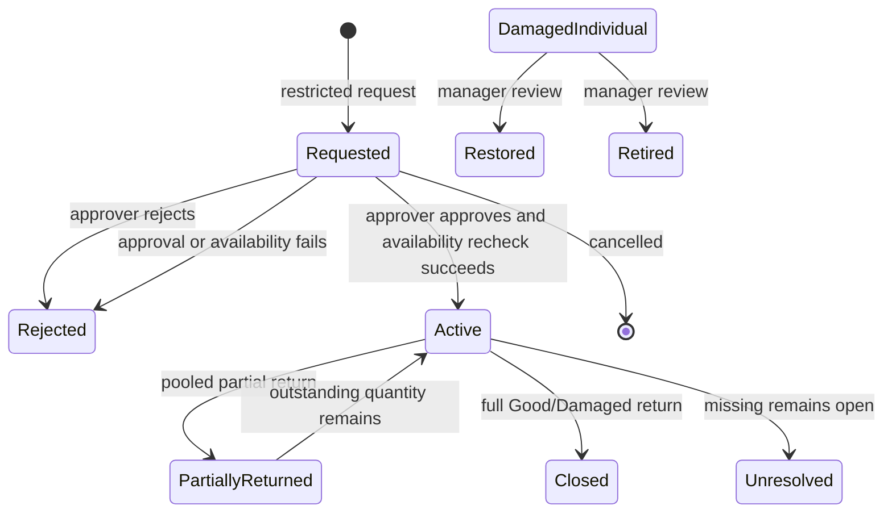

# Architecture Spine - Equipment Tracking System

## Design Paradigm

Use a single deployable modular monolith. Feature-oriented application services
own use cases and transaction boundaries; domain entities and policies enforce
invariants; infrastructure owns EF Core, SQLite, Identity, and clock/token
adapters; the Angular client calls only the public HTTP API.

Dependency direction:



## Invariants and Rules

### AD-1 - Backend owns all custody mutations [ADOPTED]

- **Binds:** FR-6, FR-7, FR-8, FR-9, FR-10, NFR-Correctness
- **Prevents:** UI-only availability checks, endpoint bypasses, and duplicated business rules
- **Rule:** All checkout, approval, return, correction, damaged-stock review, and
  kit operations enter one backend application service. Controllers and Angular
  code validate shape only; they never mutate availability or custody directly.

### AD-2 - Individual and pooled inventory are separate models

- **Binds:** FR-3, FR-4, FR-5, FR-6, FR-9, FR-10
- **Prevents:** fake serial identities for pooled stock and pooled arithmetic leaking
  into individual-asset state
- **Rule:** `EquipmentType` selects `Individual` or `Pooled`. Individual assets
  have unique asset numbers and a condition/lifecycle state. Pooled equipment
  stores `TotalQuantity`, `AvailableQuantity`, `CheckedOutQuantity`, and
  `DamagedQuantity`; all are non-negative integers and
  `Available + CheckedOut + Damaged = Total`.

### AD-3 - Custody history is relational and returns are append-only events

- **Binds:** FR-9, FR-12, FR-13, NFR-Auditability
- **Prevents:** overwritten return history, loss of partial-return detail, and
  event-sourcing complexity
- **Rule:** `CustodyRecord` stores the original borrower, checkout, due, and
  outstanding state. Every return creates an immutable `ReturnEvent`. Meaningful
  corrections, approvals, rejections, and reviews create append-only
  `AuditRecord` rows; prior custody and return facts are not deleted.

### AD-4 - Every availability-changing command is atomic

- **Binds:** FR-6, FR-7, FR-9, FR-10, FR-14, SM-6
- **Prevents:** oversubscription, duplicate active assets, over-returns, and
  custody/audit partial updates
- **Rule:** The application opens one SQLite write transaction, reloads the
  relevant rows, validates current state, mutates inventory and custody, writes
  audit data when required, and commits once. A failed validation or concurrency
  conflict rolls back every mutation. Write conflicts return a retryable
  conflict response; the client does not guess success.

### AD-5 - Database constraints backstop application checks

- **Binds:** FR-3, FR-6, FR-9, FR-10, SM-6
- **Prevents:** races or future endpoints bypassing in-memory checks
- **Rule:** Enforce unique asset numbers and a unique active individual custody
  relationship with a filtered/partial unique index where supported. Use
  non-negative quantity checks, required foreign keys, and a concurrency/version
  value on mutable inventory rows. The service must still perform conditional
  quantity updates and handle constraint/concurrency failures explicitly.

### AD-6 - Approval is a gate, never a reservation

- **Binds:** FR-7, FR-8, PRD contradiction flag
- **Prevents:** pending requests reserving stock, manager bypasses, and approval
  being applied to only one checkout path
- **Rule:** A restricted request is `Pending`, `Approved`, `Rejected`, or
  `Cancelled`; `Pending` creates no custody and changes no availability.
  Approval rechecks availability and creates the checkout in the same
  transaction. Every self-service, office-assisted, manager-created, and kit
  path calls the same approval gate. Manager/Admin authority never substitutes
  for the configured approver.

### AD-7 - State is derived from separate operational facts

- **Binds:** FR-5, FR-11, FR-12, FR-13
- **Prevents:** an overloaded status enum that cannot represent overdue,
  damaged, approval-pending, and unresolved-missing simultaneously
- **Rule:** Availability, approval state, due state, asset condition, and
  unresolved custody are separate fields/relations. Due Soon and Overdue are
  read-time projections from the injected clock and expected return time;
  they do not mutate custody.

### AD-8 - Authentication and authorization are server-enforced

- **Binds:** FR-1, FR-2, FR-8, FR-10, NFR-Security
- **Prevents:** shared identity, client-only role checks, and insecure password storage
- **Rule:** Use ASP.NET Core Identity with local seeded users, secure framework
  password hashing, role claims, and bearer/session authentication suitable for
  the Angular client. Controllers and application services enforce role and
  approver checks. Demo credentials are local-only and never production secrets.

### AD-9 - Seeded approval configuration is the MVP boundary

- **Binds:** FR-7, restricted-equipment rules, two-day scope
- **Prevents:** hard-coded drone behavior spread through checkout code while
  avoiding an unsafe configuration subsystem in the timebox
- **Rule:** Store restricted-equipment rules and approver assignments as data and
  seed the drone/Hamza rule. No configuration UI/API is required for Must;
  future configuration must change data, not checkout logic. The possible
  GPS-rover rule remains unset until configured.

### AD-10 - Startup is deterministic and local

- **Binds:** NFR-Run-Readiness, SM-1..SM-7
- **Prevents:** reviewer setup failure, missing schema, non-repeatable demos,
  and committed real credentials
- **Rule:** A repository script restores dependencies, builds the Angular
  production bundle, initializes/applies EF Core schema to a predictable
  writable SQLite path, seeds idempotent demo data, and starts the reviewable
  application. The README documents one command, local-only demo credentials,
  database reset, and no external database or cloud dependency.

### AD-11 - Angular is a thin responsive client

- **Binds:** NFR-Usability, FR-5, FR-6, FR-7, FR-9, FR-12
- **Prevents:** duplicated domain logic and a UI architecture that cannot share
  fast field and office workflows
- **Rule:** Organize Angular by feature (auth, availability, custody, approvals,
  history, administration) with shared API, auth, error, and responsive-layout
  services. Use typed request/response models, route guards for UX only, and
  treat API authorization as authoritative.

### AD-12 - Survey kits are an atomic extension point

- **Binds:** FR-14, DECISIONS.md decision 15, two-day MVP boundary
- **Prevents:** partial multi-equipment checkout and a second kit-specific
  custody model
- **Rule:** A future kit command preflights every component through the same
  application services and commits all component custody records in one
  transaction. Implement it only after Must journeys pass; otherwise leave it
  Deferred and use separate component checkouts.

### AD-13 - Operational scope remains a single local deployment

- **Binds:** NFR-Run-Readiness, two-day implementation constraint
- **Prevents:** accidental cloud, microservice, distributed-lock, or production
  operations work entering the assignment MVP
- **Rule:** The supported environment is one Windows developer/reviewer machine,
  one ASP.NET Core process, Angular static assets served by that process, and
  one writable SQLite file. No microservices, queues, cloud database, offline
  sync, or external notification dependency is part of the MVP.

### AD-14 - Commands and entity ownership are explicit

- **Binds:** all mutating endpoints, FR-6 through FR-10, FR-13
- **Prevents:** duplicate command implementations, invalid mixed custody rows,
  missing actor attribution, and privileged mutations without audit evidence
- **Rule:** Each mutation has one owner: `Custody.Checkout`,
  `Approvals.Request`, `Approvals.Decide`, `Custody.Return`,
  `Custody.Correct`, `Equipment.ReviewIndividualDamage`, or
  `Equipment.ReviewPooledDamage`. API handlers call only that owner and never
  resolve `DbContext` or mutation repositories. A `CustodyRecord` references
  exactly one individual asset or one pooled equipment type (XOR); pooled
  records have integer quantities and individual records do not. Borrower,
  checkout actor, return actor, approver, correction actor, and reviewer are
  separate required user references where applicable.

### AD-15 - Pooled custody and stock counters reconcile

- **Binds:** FR-4, FR-9, FR-10, SM-2, SM-6
- **Prevents:** dashboard quantities disagreeing with borrower-level custody
- **Rule:** For each pooled type,
  `CheckedOutQuantity = SUM(outstanding quantity of every open pooled
  CustodyRecord)`. Every checkout, return, correction, missing declaration, and
  damage review updates or validates this equation in the same transaction.
  `AvailableQuantity + CheckedOutQuantity + DamagedQuantity = TotalQuantity`
  remains true after commit.

### AD-16 - Restricted requests have one complete lifecycle

- **Binds:** FR-7, FR-8, AD-6
- **Prevents:** duplicate requests, stranded approvals, and approval-time
  availability ambiguity
- **Rule:** `POST /api/approvals/requests` is the sole request-creation command;
  restricted checkout requests return `202 Pending` and create no custody.
  Approval is a single transaction that changes `Pending` directly to `Active`
  when availability succeeds, or to `Rejected` with a reason when it cannot.
  There is no durable approved-but-unfulfilled state. Approval requests capture
  borrower, requested quantity/asset, due/location, and the rule/approver
  snapshot; one configured approver decision is required for the seeded drone.

### AD-17 - Open custody remains unique and missing is not returned

- **Binds:** FR-9, FR-12, missing-equipment guardrail
- **Prevents:** re-checking out an unresolved individual asset or inventing a
  return to close missing custody
- **Rule:** `OpenCustody` includes Active, PartiallyReturned, and Unresolved;
  an individual asset has at most one open custody record. Missing declaration
  and resolution are outside the two-day Must API; an unresolved item remains
  open and unavailable, with no return event until a later recovery workflow is
  defined. Individual custody permits exactly one return event and rejects
  returns after closure.

### AD-18 - Availability reads use one authoritative model

- **Binds:** FR-5, FR-6, FR-9, FR-10, NFR-Correctness
- **Prevents:** independently implemented availability queries disagreeing after
  concurrent writes
- **Rule:** Stored asset state and pooled counters are the authoritative write
  model. Availability endpoints project from those rows plus open custody;
  they do not maintain a second cache. Every committed command returns the
  committed resource version; a `409` requires the client to reload before
  retrying.

### AD-19 - Business time policy is shared

- **Binds:** FR-6, FR-11, NFR-Usability
- **Prevents:** API and Angular disagreeing about tomorrow, Due Soon, or Overdue
- **Rule:** Persist UTC, use one configured MVP business timezone for calendar
  calculations, and inject one server clock. “Tomorrow” means the next
  business-time calendar day at the configured default checkout time; Due Soon
  is within one calendar day and not overdue, using one documented boundary
  policy. Angular displays server-derived labels rather than recalculating them.

## Consistency Conventions

| Concern | Convention |
| --- | --- |
| Naming | C# PascalCase types/properties; feature folders named for use cases; Angular feature folders and TypeScript symbols use the existing Angular style; database names map explicitly in EF configuration. |
| IDs and time | Use generated GUID/UUID identifiers for relational records; asset numbers remain human-readable unique values; persist UTC timestamps; use `Asia/Karachi` for calendar calculations and display; inject a clock for due-status tests. |
| API shape | REST JSON endpoints under `/api`; resource-oriented paths; DTOs at the boundary; validation errors use `400`; unauthenticated `401`; forbidden `403`; missing `404`; state/concurrency conflicts `409`; problem-details style error body. |
| Mutation | Commands live in application services and return explicit result/DTO values; queries are read-only and can project directly to response DTOs. |
| Audit | Audit rows include actor, UTC timestamp, action, entity reference, reason/decision, and old/new values where relevant; each owning command writes its audit row in the same transaction; audit rows have no update/delete path. |
| Configuration | Connection string and writable database path are environment-overridable, with a safe local default; no secrets are committed. |
| Error handling | Expected validation and concurrency failures are explicit typed results; unexpected failures use standard logging and a safe problem-details response, never a success-shaped fallback. |

## Stack

| Name | Version |
| --- | --- |
| C# / .NET / ASP.NET Core | `net8.0`, ASP.NET Core 8.0 (SDK 8.0.427; do not rely on SDK defaults) |
| Entity Framework Core | 8.0 |
| SQLite | 3.x via Microsoft.EntityFrameworkCore.Sqlite 8.0 |
| ASP.NET Core Identity | 8.0 |
| Angular | 21.2.16 CLI, standalone components |
| TypeScript | 5.9.x, pinned in `package.json` and lockfile (Angular 21-compatible) |
| BMAD Method | 6.12.4 |
| Node.js / npm | 24.13.0 / 11.6.2 |
| .NET SDKs / runtime | 8.0.427 and 10.0.401 installed; ASP.NET Core runtime 8.0.33 |
| Development/review platform | Windows with VS Code |

## Structural Seed

```text
/
  src/
    EquipmentTracking.Api/
      Features/
        Auth/
        Equipment/
        Custody/
        Approvals/
        History/
        Administration/
      Domain/
      Infrastructure/
      Common/
    equipment-tracking-web/
      src/app/
        auth/
        availability/
        custody/
        approvals/
        history/
        administration/
        shared/
  tests/
    EquipmentTracking.UnitTests/
    EquipmentTracking.IntegrationTests/
  docs/
    architecture/
  scripts/
    start-review.ps1  # explicitly uses --framework net8.0
  data/
    equipment-tracking.db   # generated, writable, ignored
  README.md
  DECISIONS.md
```

Core entity relationships:



Checkout and approval lifecycle:



Transaction boundary:

```text
HTTP request
  -> application command
     -> begin SQLite write transaction
        -> reload and validate current rows
        -> mutate inventory + custody/approval/return
        -> append audit record when required
        -> commit or rollback everything
  -> response
```

## Backend Organization and Responsibilities

- `Features/Auth`: Identity endpoints and current-user projection.
- `Features/Equipment`: catalogue, availability projection, asset/pooled setup,
  and damaged-stock review commands.
- `Features/Custody`: self-service, office-assisted, return, and correction
  commands; shared availability/approval policies.
- `Features/Approvals`: pending request and configured approver decision flow.
- `Features/History`: custody, return-event, audit, and due-status queries.
- `Domain`: entities, enums, invariant policies, and domain validation with no
  HTTP or EF dependencies.
- `Infrastructure`: `DbContext`, Identity stores, EF mappings, migrations,
  transaction/concurrency helpers, seed data, and clock/token adapters.
- `Common`: problem-details mapping, authorization constants, pagination/filter
  primitives, and observability.

## Compact Domain Model

- `ApplicationUser`, Identity roles, and user-role membership.
- `EquipmentType`: name, tracking mode, optional restricted rule, and pooled
  quantities.
- `IndividualAsset`: asset number, optional serial, condition/lifecycle state,
  and parent equipment type.
- `CustodyRecord`: borrower, performing actor, equipment/asset reference,
  original quantity, outstanding quantity, due time, declared location, and
  lifecycle.
- `ReturnEvent`: immutable actor/time, individual condition or pooled Good and
  Damaged quantities, and note.
- `ApprovalRequest`, `ApprovalDecision`, and `ApprovalRule`.
- `AuditRecord`: append-only decision/correction/review evidence.

Custody ownership is exclusive: an individual record has `IndividualAssetId`
only; a pooled record has `EquipmentTypeId` only. Open pooled custody
outstanding quantities must reconcile to the equipment type's checked-out
counter. Unresolved missing custody remains open and unavailable; the MVP does
not expose a missing-resolution command.

## REST API Contract Seed

| Area | Endpoint shape | Purpose |
| --- | --- | --- |
| Auth | `POST /api/auth/login`, `POST /api/auth/logout`, `GET /api/auth/me` | Sign in/out and current identity |
| Availability | `GET /api/equipment`, `GET /api/equipment/:id` | Search current availability, custody, due, and condition |
| Equipment admin | `POST /api/equipment/types`, `POST /api/equipment/assets` | Create pooled types or individual assets |
| Checkout | `POST /api/custody/checkouts` | Standard or office-assisted unrestricted checkout through shared gates |
| Returns | `POST /api/custody/:id/returns` | Full/partial Good or Damaged return |
| Corrections | `POST /api/custody/:id/corrections` | Office/manager correction with reason and audit |
| Approvals | `POST /api/approvals/requests`, `GET /api/approvals/pending`, `POST /api/approvals/:id/approve`, `POST /api/approvals/:id/reject` | Restricted request and decision lifecycle; approval activates custody atomically or rejects with reason |
| Review | `POST /api/assets/:assetId/damage-review`, `POST /api/equipment-types/:typeId/damaged-stock/reviews` | Separate individual restore/retire and pooled damaged-stock restore commands |
| History | `GET /api/history?equipmentId=&from=&to=` | Custody, returns, approvals, and relevant audit projection |

## Tests

- Domain/unit tests for pooled arithmetic, mixed-condition partial returns,
  over-return rejection, individual lifecycle, due labels, and role/approval
  policy decisions.
- EF/integration tests against a temporary SQLite database for migrations,
  unique asset numbers, active individual uniqueness, and foreign keys.
- Transaction/concurrency tests for two simultaneous individual checkouts,
  competing pooled checkouts, approval-time availability loss, over-return,
  mixed-equipment rollback, and custody-plus-audit atomicity.
- Reconciliation tests for open pooled custody totals, XOR individual/pooled
  references, one individual return event, unresolved custody uniqueness, and
  immutable audit rows.
- API authorization tests for every role and every restricted path, including
  manager-created checkout without approval.
- Startup smoke test for schema creation, idempotent seed, health/readiness,
  demo login, and the four minimum demonstration journeys.
- Angular tests for login, availability rendering, checkout/return forms,
  approval actions, conflict/error display, and responsive critical controls.

## Must, Should, Deferred

**Must:** named login and role enforcement; individual and pooled catalogue;
availability/custodian view; standard checkout and return; pooled partial mixed
returns; damage quarantine/review; backend-enforced drone approval; audit/history;
transactional correctness; deterministic seed and one-command startup.

**Should:** seeded-but-not-configurable rule administration; richer filters and
history presentation; atomic predefined survey-kit shortcut; office correction
UI beyond the safe endpoint; refined Due Soon display.

**Deferred:** WhatsApp/email; GPS; offline sync; procurement; depreciation; full
maintenance; full missing-item incidents; SSO; dynamic or partial kit modeling;
individual labels for pooled stock.

## Reviewer Startup Version Contract

The startup script must verify Node.js `24.13.0` (or a compatible Angular 21
runtime), restore the Angular 21 lockfile, and build standalone Angular
components. It must explicitly invoke the .NET 8 SDK/toolchain and pass
`--framework net8.0` to restore, build, migrate, test, and run commands; the
installed .NET 10 SDK must never select the target implicitly. The API project
must declare `<TargetFramework>net8.0</TargetFramework>` and use EF Core 8
packages. The script then initializes the writable SQLite database, applies EF
Core migrations, seeds deterministic demo data, and starts the single review
process. README startup instructions must list the verified versions and the
local-only demo accounts.

## Assumptions, Risks, and Open Questions

- `[ASSUMPTION]` Due Soon uses the PRD's one-calendar-day warning window.
- `[ASSUMPTION]` Local Identity credentials are acceptable for a hiring-assignment
  demonstration and are not a production identity design.
- The approved .NET 8 choice reaches end of support on 2026-11-10 according to
  current Microsoft guidance. Do not silently change it; record the risk and
  confirm whether the assignment requires .NET 8 specifically before scaffolding.
- Angular's exact major version is intentionally pinned during scaffold rather
  than guessed in this spine; it must be recorded in the implementation
  dependency manifest and kept compatible with the selected Node toolchain.
- Kit seed contents beyond required demo inventory remain an open product detail;
  the kit shortcut must be cut first if atomic processing cannot be demonstrated.
- The 7-day, 4-day, and interview-relative deadlines remain a documented
  planning contradiction from the source requirements; the two-day MVP is the
  conservative implementation scope.

## Deferred Architecture Decisions

- Production identity/SSO and secret management.
- Whether restricted-equipment rules need a Manager/Admin configuration UI after
  the MVP.
- Deployment outside the local single-process reviewer environment.
- Notification delivery and offline synchronization architecture.
- Full missing-item incident and maintenance workflows.
